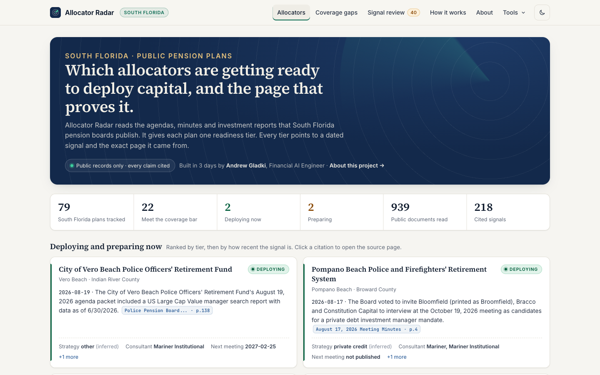
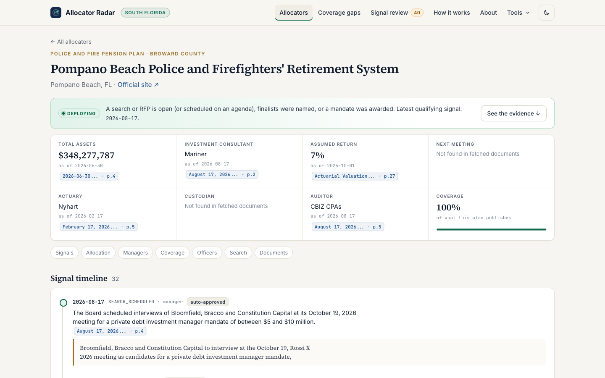
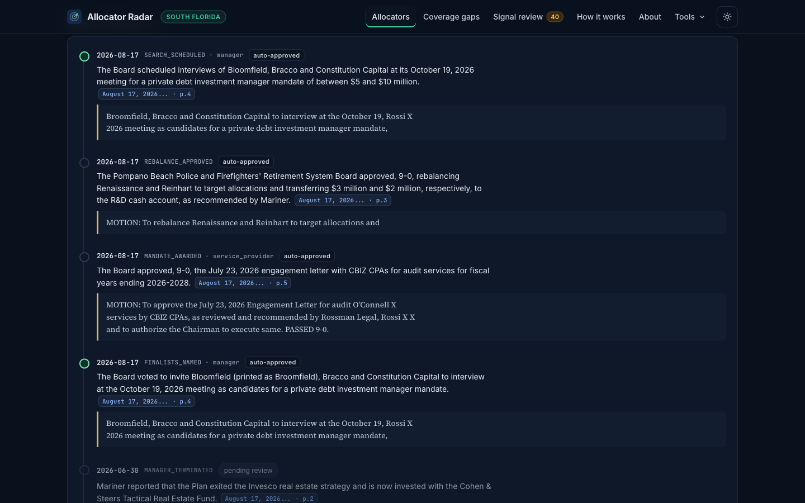
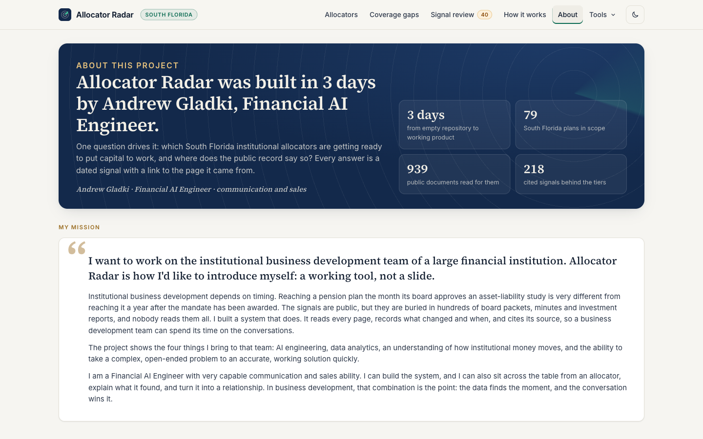

# Allocator Radar

[](https://github.com/gladkiandrew/allocator-radar/actions/workflows/ci.yml)
[](LICENSE)

**Which South Florida public pension plans are getting ready to put money to work, and the public
document that says so.**

Pension boards record their investment decisions in their own paperwork: a vote to search for a
new private-credit manager, a raised target allocation, a newly adopted asset-liability study. All
of it is public record, but it is spread across hundreds of agenda packets, minutes and investment
reports that nobody reads in full. Allocator Radar reads them. It puts each plan in one of four
readiness tiers and links every tier to the dated page of the document that set it.

For an institutional business development team, that answers two questions: which plans to call
this month, and what in the public record shows why.

> **Built by Andrew Gladki, Financial AI Engineer.** I want to work on the institutional
> business development team of a large financial institution. This project shows what I would
> bring to that team: AI engineering, data analytics, an understanding of how institutional capital
> moves, and the ability to take a complex, open-ended problem to an accurate, working solution
> quickly. I pair the engineering with very capable communication and sales ability. The app's
> **About** page tells the full story.

## Screenshots

From a local run on 2026-11-09: 79 South Florida plans in scope, 939 public documents read, 218
cited signals.



<table>
  <tr>
    <td width="50%"></td>
    <td width="50%"></td>
  </tr>
  <tr>
    <td>A plan brief. The tier, the signal that set it, and each fact with its source document and page.</td>
    <td>The signal timeline (dark mode). Every signal quotes the passage it came from.</td>
  </tr>
</table>



## What you see

The main screen is one table. Each row is a plan with a readiness tier: **DEPLOYING**,
**PREPARING**, **WATCHING** or **STALE**. Next to the tier is the signal that set it, the date it
happened, and a link to the exact page of the source PDF. Click a plan to see its brief:

- what it holds, as disclosed
- its incumbent managers and its consultant
- officers and trustees, as printed
- a signal timeline
- every document we watch

Every line cites a public document and page. Nothing is an opinion.

## How a tier is set

The rules live in `config/readiness_rules.yaml` and are shown on the app's **How this works** page.

| Tier | Rule |
|---|---|
| DEPLOYING | An investment-manager search or RFP is open, finalists were named, or a mandate was awarded in the last 90 days |
| PREPARING | In the last 180 days: target allocation raised, IPS amended, asset-liability or pacing study adopted, consultant changed, or an incumbent placed on watch or terminated |
| WATCHING | A new document was fetched in the last 120 days, but no qualifying signal is in the window |
| STALE | No new document fetched in 120 days. This describes our coverage, not the plan |

Only **approved** signals count toward a tier. Dates are the ones printed in the source (the
meeting, notice or filing date), never the date we fetched the document.

## The Wall

These rules hold in every configuration.

1. **No contact details, anywhere.** No data model has an email, phone, address or social-profile
   field. People appear only as name and title, exactly as a public document prints them. Every
   piece of text passes through a scrubber (regex plus a GLiNER PII model) before it reaches the
   language model, the search index or any table. Contact-shaped text becomes `[REDACTED-CONTACT]`.
2. **No outbound capability.** The crawler sends only GET and HEAD requests, and only to hosts on
   the allowlist in `config/sources.yaml`. It honors robots.txt, including rules aimed at AI agents.
   It never submits forms or logs in. It stops at any bot wall and never works around one. There is
   no email, messaging or form library in the codebase, and a test fails the build if one appears.
3. **Public, login-free sources only.** Sources whose terms forbid automation are *manual-only*. A
   person reads them in a browser and enters a dated, cited fact by hand.
4. **Tested every night.** `radar wall` checks four things: the schema, a sweep of every stored
   text value and search-index payload, the egress log, and a canary packet of fake contact details
   run through the real pipeline. Any hit fails the run.

## Legal posture, in plain English

- **The data is public by law.** Florida plan documents (agendas, minutes, investment reports,
  investment policy statements, actuarial valuations) are public records under Florida Chapter 119
  and the Sunshine Law. F.S. 112.664 requires local plans to post financial disclosures on their
  websites.
- **We read only what anyone can read without logging in**, at polite rates (at least 10 seconds
  between requests to a host). We follow each site's robots.txt and terms literally.
- **We store facts, not reachability.** There are no contact details. Trustees and staff appear
  only by name and title, as the documents print them.
- **No evaluative language.** A lint rejects words like "strong", "underperform", "attractive" or
  "likely" in every stored summary. The output is a list of cited facts, not marketing material.
  Anything you send to a prospect is yours to write and to have compliance review.
- **Raw PDFs are evidence.** They are kept unredacted but encrypted at rest. Every derived layer
  is scrubbed.
- **Your own regulatory status** sets the export disclaimers (`config/firm_posture.yaml`:
  `ria | cpo_cta | both | none`). Outreach to public plans can trigger lobbyist-registration and
  pay-to-play rules. That is a matter for your own policy, outside this tool.

The full source inventory and legal analysis are in `docs/AGENDA.md` (§2 and §7). The product brief
is in `docs/BRIEF.md`. Every build decision is logged in `DECISIONS.md`.

## Quick start

You need macOS or Linux and [uv](https://docs.astral.sh/uv/). uv installs Python 3.12 for you.

```bash
git clone https://github.com/gladkiandrew/allocator-radar.git
cd allocator-radar
uv sync                 # Python 3.12 + dependencies, pinned by uv.lock
uv run radar init       # creates the local DuckDB database in data/
uv run radar serve      # http://localhost:8000
make test               # unit + wall tests: no network, no keys, no LLM
```

The repository holds the code and the plan registry (`registry/florida.yaml`). It does not include
the crawled documents or the database, so a fresh install starts empty. The web app, the tests,
crawling and PDF parsing all run without a language model. Only **extraction**, the step that turns
document pages into cited signals, calls one.

### Filling it with data

Extraction needs the [Claude Code](https://claude.com/claude-code) CLI logged in to a Claude
subscription (`claude auth status`). To use the Anthropic API instead, copy `.env.example` to
`.env` and set `RADAR_LLM_BACKEND=anthropic` and `ANTHROPIC_API_KEY`.

1. Open **Registry** (http://localhost:8000/registry) and approve the plan list. This loads the
   plans from `registry/florida.yaml` and queues their listing pages for the crawler.
2. Crawl one plan: `uv run radar crawl --only fl-pompano-pf`. The crawler is slow on purpose: at
   least 10 seconds between requests to the same host.
3. Extract signals from what was fetched: `uv run radar extract --only fl-pompano-pf`.
4. Approve the signals on **Signal review**, or run `uv run radar approve-pending` to apply
   `config/review_policy.yaml` (see the review policy below).

The full pipeline, for every approved plan:

```bash
uv run playwright install chromium     # only for JavaScript-rendered plan sites
uv run radar discover                  # optional: rebuild registry/florida.yaml from registry/seed_florida.yaml
uv run radar nightly                   # crawl -> extract -> approvals policy -> index -> wall
uv run radar status                    # one-shot summary: plans, tiers, signals, documents
make wall                              # wall tests including the slow model-based ones (downloads GLiNER)
```

Scanned PDFs are read with local OCR: Apple Vision on macOS, Tesseract on Linux (install the
`tesseract` binary). `uv run radar --help` lists every command.

### Tests and CI

`make test` runs the unit and wall tests. Each test gets its own temporary data directory, database
and encryption key, so the suite needs no `data/`, no key file and no model. GitHub Actions runs the
same command on every push and pull request (`.github/workflows/ci.yml`). The slow GLiNER tests are
opt-in (`make wall`).

## Stack

Python 3.12 and uv · FastAPI with Jinja templates and HTMX · DuckDB (SQL kept Postgres-portable) ·
pdfplumber with local OCR for scanned pages · regex plus a GLiNER model for PII scrubbing · LanceDB
hybrid search (BM25 full text plus vectors) over scrubbed pages · Claude through headless
`claude -p` or the Anthropic API, behind one adapter.

| Path | What it holds |
|---|---|
| `src/radar/crawl/`, `net/` | allowlisted, robots-aware fetcher (GET/HEAD only) |
| `src/radar/parse/`, `extract/` | PDF parsing, keyword prefilter, LLM extraction of cited signals |
| `src/radar/readiness.py` | tier rules applied to approved signals |
| `src/radar/wall/` | scrubber, evaluative-language lint, canary and live sweeps |
| `src/radar/web/` | the FastAPI app, templates and static assets |
| `config/` | readiness rules, sources allowlist, scope, review policy, wall config |
| `registry/` | the Florida plan list and the pages to crawl |
| `tests/` | unit tests and the wall tests (`tests/wall/`) |

## The people in the loop

| Touchpoint | Where |
|---|---|
| Registry approval | **Registry**: approve the plan list and the pages to crawl |
| Signal review | **Signal review**: approve, correct or reject each signal. See the review policy below |
| Manual facts | **Manual fact**: URL + date + plan + fact, for sources the system never fetches |
| Public-records requests | **Records requests**: track Chapter 119 requests a person files. Drop the responses in the request's folder and ingest them. The system never sends anything |

**Review policy.** `config/review_policy.yaml` can auto-approve signals and registry versions that
pass every machine check. Each auto-approved row is stamped with the policy's name, never a
person's, and can still be rejected on the review page. Set `auto_approve: false` to review
everything by hand.

## LLM backends

There is one adapter (`src/radar/llm/provider.py`). Model names live in config, never in code.

- `claude_code` (default): headless `claude -p` on the owner's Claude subscription. It runs with
  tools, MCP and settings disabled, in an empty working directory, with API keys stripped from its
  environment.
- `anthropic`: the Anthropic API with `ANTHROPIC_API_KEY`.
- `local`: a stub for an OpenAI-compatible endpoint.

Only scrubbed public-document text is ever sent to a model.

## Endowments & Foundations (Phase C)

The **Endowments & Foundations** tab covers the 48 largest Florida university foundations, private universities,
community foundations and private foundations, chosen by assets from the IRS exempt-organization master file
(`data/ef_universe.csv` lists each one with its source). Each organization's last three IRS Form 990 / 990-PF returns
are read straight from the IRS e-file XML. From them come total and investment assets, alternative and other-investment
lines, and the investment firms named among the five highest-paid independent contractors (firm names only: people are
never stored), plus year-over-year changes. Every figure cites the tax year, part and line.

990s are annual and lag, so a 990 alone never sets a tier above WATCHING. DEPLOYING or PREPARING needs a dated committee
or board document that the organization publishes itself; three university foundations publish theirs.

```bash
uv run radar ef-load        # universe -> ProPublica summaries -> IRS 990 XML -> 990 signals (data/ef.duckdb)
uv run radar ef-committee   # the foundations' own committee/board documents -> dated signals
```

## Scope

The app is set to **South Florida**: Miami-Dade, Broward, Palm Beach and Monroe counties, plus the
Treasure Coast (St. Lucie and Indian River), plus the statewide Florida Retirement System. That is
79 plans. The crawler and the database cover every Florida plan in the registry (251). To show all
of them, set `region: florida` in `config/scope.yaml`. Scope only filters what the pages, the review
queue and the export show.

## Access gate

**Off by default.** With no `RADAR_GATE` set, the local app and `make deploy-public` behave exactly as
before: the local app is the owner's full app, and the public site is the open read-only snapshot.

Three audiences:

| Audience | Sees |
|---|---|
| public | the open read-only site: approved signals, briefs, gaps, how it works. No contacts, no export. With the gate on, only the password page. |
| member | the full read-only site, including contacts. No review, tools or export. |
| admin | everything: review, tasks, export, manual facts, records requests, registry. |

Every template gets `audience` (`public`, `member` or `admin`) plus `can_see_contacts` and `can_admin`.
Without the gate the local app is `admin` and the public build is `public`; with the gate it is the
signed-in role.

**Local app with the gate on.** Make the password hashes and a session secret, put them in `.env`
(git-ignored; see `.env.example`), and start the app:

```bash
uv run radar hash-password        # prompts; prints pbkdf2_sha256$100000$<salt>$<hash>
# .env
RADAR_GATE=on
RADAR_MEMBER_PASSWORD_HASH=pbkdf2_sha256$...
RADAR_ADMIN_PASSWORD_HASH=pbkdf2_sha256$...
RADAR_SESSION_SECRET=...          # python -c 'import secrets; print(secrets.token_hex(32))'
make serve
```

`/login` takes a password (no username) and sets a signed, HttpOnly, SameSite=Lax cookie that records
the role for 12 hours (`RADAR_SESSION_TTL_HOURS`). `/logout` clears it. Every other path except
`/static/*` and `/healthz` redirects to `/login` without it, and a member gets 403 on the admin paths.
Repeated wrong passwords back off. Without `RADAR_SESSION_SECRET` or a password hash, the app refuses
to start. The gate replaces `RADAR_AUTH_MODE=basic` while it is on; basic auth still works with the
gate off, and accepts the same `radar hash-password` output (or the old sha256 hex).

**Gated members site.** A separate Worker (`deploy/gate-worker.js`, `wrangler.gated.jsonc`) serves the
member build only after the password check; otherwise it serves only the login page. Set its two
secrets once, then deploy:

```bash
npx wrangler secret put GATE_SESSION_SECRET -c wrangler.gated.jsonc        # random, 32+ characters
npx wrangler secret put GATE_MEMBER_PASSWORD_HASH -c wrangler.gated.jsonc  # radar hash-password output
make deploy-gated   # export-static --audience member -> wall-static --audience member -> wrangler deploy
```

Pick its hostname in `wrangler.gated.jsonc` first. The wall check knows which build it is reading: in
the public build any block marked `data-audience="member"` or `"admin"` (or `class="contacts"`) fails
it; in the member build contact details may appear only inside member blocks, and admin pages and links
still fail it.

**Rate-limit the login (do this before switching the gated site on).** The Worker keeps no state, so it
can't count failed logins itself; PBKDF2 at 100,000 iterations slows each guess but doesn't cap them.
Add a Cloudflare rate-limiting rule in front of it. WAF rules run only on a zone, so the gated site must
be on a custom domain in the `amagna.co` zone (uncomment the `routes` entry in `wrangler.gated.jsonc`),
not on `workers.dev`.

The rule, in the dashboard: *amagna.co → Security → WAF → Rate limiting rules → Create rule*.

| Field | Value |
|---|---|
| Rule name | `gate-login-bruteforce` |
| If incoming requests match | `(http.host eq "<gated hostname>" and http.request.uri.path eq "/login" and http.request.method eq "POST")` |
| With the same characteristics | IP |
| When rate exceeds | 5 requests per 1 minute |
| Then take action | Block (or Managed Challenge) |
| For duration | 10 minutes |

Plan limits apply: on the Free plan the counting period and the block duration are fixed at 10 seconds,
so use 5 requests per 10 seconds there; Pro and above allow the values in the table. The same rule as an
API call (a token with *Zone WAF: Edit*; `ZONE_ID` from the zone's overview page):

```bash
curl -X POST "https://api.cloudflare.com/client/v4/zones/$ZONE_ID/rulesets/phases/http_ratelimit/entrypoint/rules" \
  -H "Authorization: Bearer $CF_API_TOKEN" -H "Content-Type: application/json" --data '{
    "description": "gate-login-bruteforce",
    "expression": "(http.host eq \"<gated hostname>\" and http.request.uri.path eq \"/login\" and http.request.method eq \"POST\")",
    "action": "block",
    "ratelimit": {"characteristics": ["ip.src", "cf.colo.id"], "period": 60,
                  "requests_per_period": 5, "mitigation_timeout": 600}
  }'
```

If the zone has no `http_ratelimit` entrypoint ruleset yet, that call returns 404. Create the rule in the
dashboard once, or `PUT` the whole entrypoint with this rule in its `rules` array. Check it afterwards:
six wrong passwords inside a minute should get a 429 or the block page. A successful login is a 302,
which also counts toward the limit, so five sign-ins a minute from one office IP is the ceiling. The
local app (`radar serve` with the gate on) has its own in-memory backoff and needs none of this.

## Deploy

**Public site.** [allocator.amagna.co](https://allocator.amagna.co/) is a static snapshot on
Cloudflare Workers, with no server and no tunnel. `make deploy-public` renders the public read-only
pages to `dist/` (`radar export-static`), runs the wall check on them (`radar wall-static dist`: no
contact details, no links to review, export or tools), then runs `npx wrangler deploy`
(`wrangler.jsonc`). Run `npx wrangler login` once first. Crawling and review stay on your machine;
redeploy to refresh the data.

**Full app.** `docker compose up -d` runs the app (login required) and a nightly worker. Put it
behind your own tunnel or reverse proxy on a subdomain. Server notes are in `deploy/VPS.md`. DuckDB
is the default store; the SQL is kept portable so it can move to Postgres.

**Members site.** See [Access gate](#access-gate): `make deploy-gated` deploys a separate, password-gated
Worker. It does not touch the public site.

## Status

Phase A covers South Florida local plans, plus the State Board of Administration via the manual
inbox. Phase B has collected every Florida local plan into the registry (the app shows South
Florida; see Scope). Phase C would add Florida endowments, foundations and hospitals, from IRS 990
data.

License: [MIT](LICENSE).
